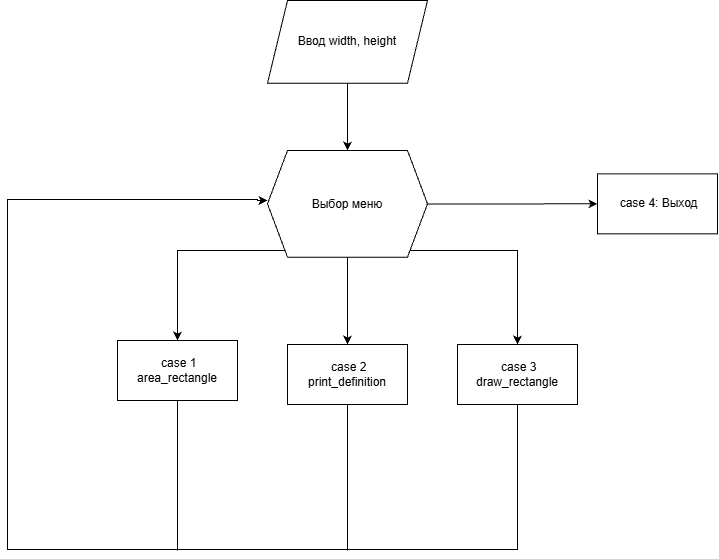

# Домашнее задание к работе 10

## Условие задачи

Разработать программу для работы с геометрической фигурой (**Вариант 26**: Треугольник).  
Программа должна реализовывать интерактивное меню со следующими возможностями:
1. Расчет площади геометрической фигуры по заданным параметрам.
2. Вывод текстового определения/свойств фигуры.
3. Псевдографическое отображение фигуры в консоли.

## 1. Алгоритм и блок-схема
### Алгоритм решения
1. **Начало**
2. Ввести исходные данные от пользователя:
   - `width` (ширина фигуры, вещественное число)
   - `height` (высота фигуры, вещественное число)
3. Отобразить меню выбора операции и считать значение `choice`.
4. В зависимости от значения `choice`:
   - Если `choice == 1`: вызвать функцию `area_rectangle(width, height)` и вывести результат.
   - Если `choice == 2`: вызвать функцию `print_definition()`.
   - Если `choice == 3`: вызвать функцию `draw_rectangle(width, height)`.
   - Если `choice == 4`: завершить работу программы.
5. Повторять шаг 3-4 до тех пор, пока не будет выбран пункт выхода.
6. **Конец**

### Блок-схема

## 2. Реализация программы

## 3. Результаты работы программы

#### РАБОТА С ГЕОМЕТРИЧЕСКОЙ ФИГУРОЙ

========================================

**УСЛОВИЯ:**
- width = 4
- alfha = 45
  
========================================

**РАСЧЁТ ПЛОЩАДИ (Пункт меню 1):**
- Формула:
  ` for (int y = 0; y < height; y++) {

        double precise_current_width = ((double)(y + 1) / height) * width;
        int current_width = (int)(precise_current_width + 0.5);

        for (int x = 0; x < current_width; x++) {
            printf("%c", sym);`
  
========================================

**Площадь треугольника: 8.00**

## 4. Информация о разработчике
  **Сёмкин Сергей Алексеевич БИЦТ 262**
